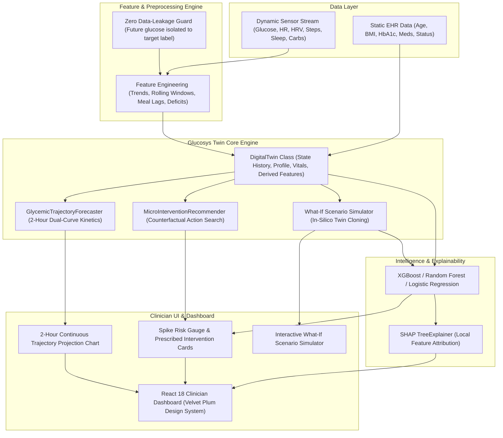

# Glucosys Twin — System Architecture

## Overview

**Glucosys Twin** is an AI Healthcare Digital Twin platform engineered for **early prediction of significant glucose spikes ($\ge 40\text{ mg/dL}$ increase)** within a **2-hour prediction horizon**, paired with **Prescribed Counterfactual Micro-Interventions** and **2-Hour Dual-Curve Glycemic Trajectory Forecasting**.

Unlike static machine learning pipelines, **Glucosys Twin** maintains a continuous, stateful digital representation of a patient's physiology by fusing static Electronic Health Record (EHR) data with high-frequency wearable sensor telemetry sampled at 15-minute intervals.

---

## High-Level Architecture Diagram

---

## Core Modules

### 1. Data Ingestion & Synthetic Generator (`src/data/`)
* **`generate_synthetic.py`**: Generates physiologically coupled EHR profiles and continuous 15-minute wearable streams incorporating circadian rhythms, carbohydrate digestion kinetics, muscular exercise clearance, and sleep deficits.
* **`process.py`**: Executes zero-leakage preprocessing, feature scaling, and train/test partitioning.

### 2. Feature Engineering & Data Leakage Guard (`src/features/build_features.py`)
* Computes 35+ temporal and clinical features including rolling statistics (1h, 2h, 4h mean/std/min/max), short-term glucose velocity (15m, 30m, 1h deltas), autonomic tone (HR and HRV RMSSD), and postprandial meal lags.
* **Data Leakage Safeguard**: Future glucose readings in the $[t+15\text{m}, t+2\text{h}]$ window are restricted strictly to target label construction (`target_spike`) and purged from all input feature vectors.

### 3. Digital Twin & Counterfactual Intelligence (`src/twin/`)
* **`digital_twin.py` (`DigitalTwin`)**: Maintains rolling sensor history, computes real-time spike probability (`predict()`), generates local SHAP explanations (`explain_prediction()`), and clones virtual patient states for counterfactual testing (`simulate()`).
* **`recommender.py` (`MicroInterventionRecommender`)**: Searches candidate micro-interventions (brisk walking, carbohydrate portion reduction, sleep recovery) against cloned twin instances to prescribe actions that bring spike risk into the Safe Zone ($< 35\%$).
* **`trajectory_forecaster.py` (`GlycemicTrajectoryForecaster`)**: Simulates 8 forward 15-minute steps ($t+15\text{m}$ to $t+120\text{m}$) comparing the **Unmitigated Trajectory** (e.g., peaking at $212\text{ mg/dL}$) against the **With Walk Counterfactual Trajectory** (blunted to $172\text{ mg/dL}$ within the $70\text{–}180\text{ mg/dL}$ safe corridor).

### 4. Machine Learning & Explainability (`src/models/`, `src/explainability/`)
* Benchmarks **Logistic Regression**, **Random Forest**, and **XGBoost** across Precision, Recall, F1-score, ROC-AUC, PR-AUC, and Confusion Matrices.
* Integrates **SHAP (`TreeExplainer`)** to expose top positive and negative physiological drivers for every individual prediction.

---

## Health Safety & Disclaimer

> **Research Proof-of-Concept:** Glucosys Twin is designed purely for academic, research, and proof-of-concept demonstration purposes. It is not intended for clinical diagnosis, medication dosing, or medical treatment decisions.
